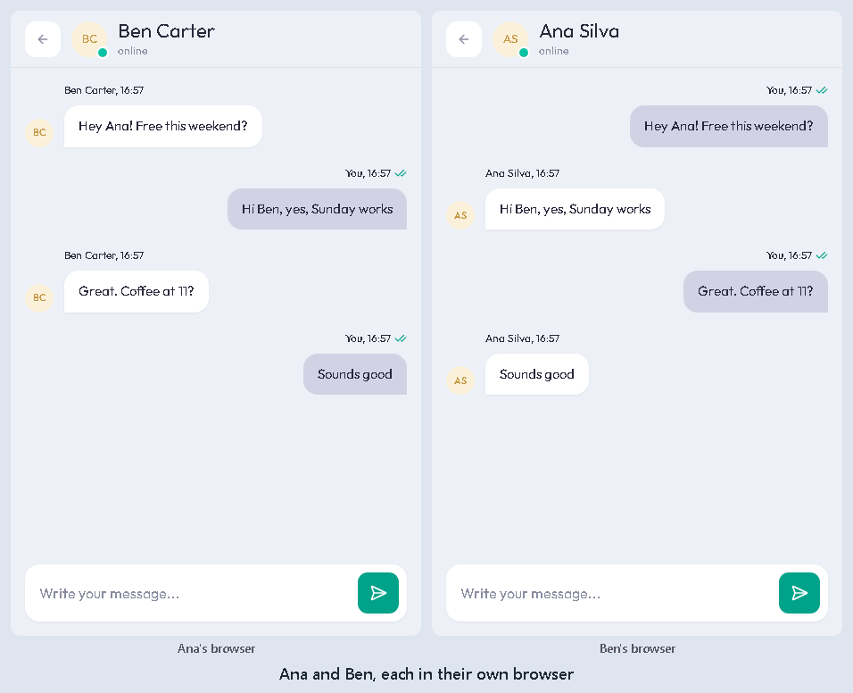
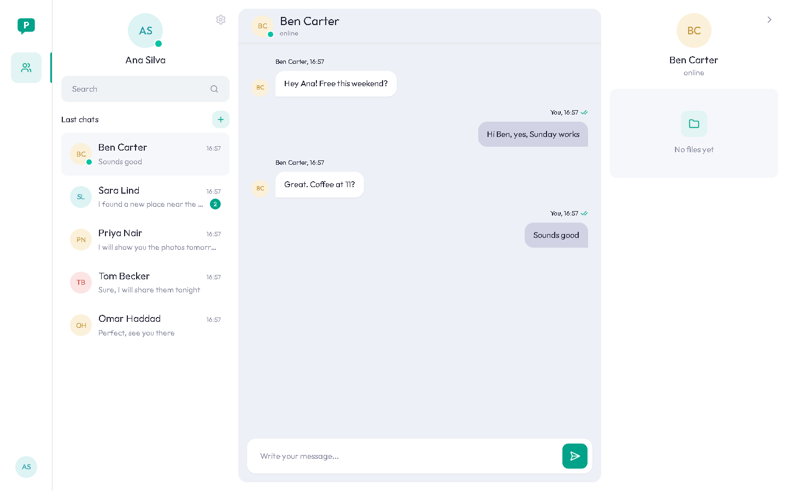
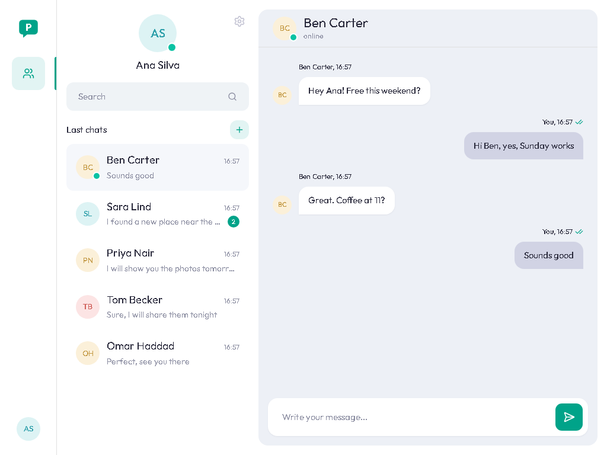
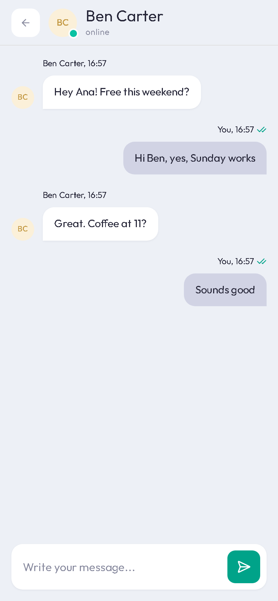
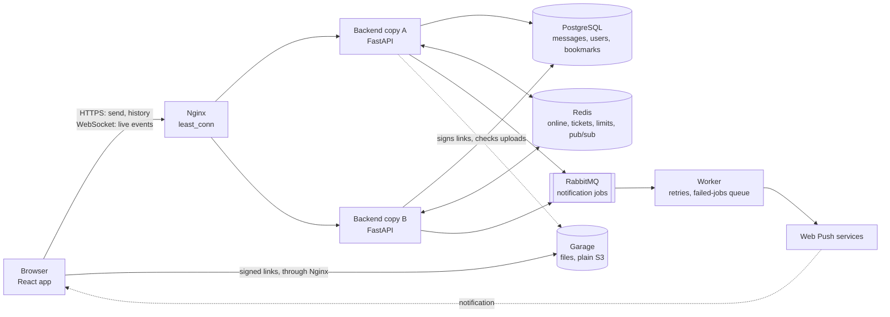
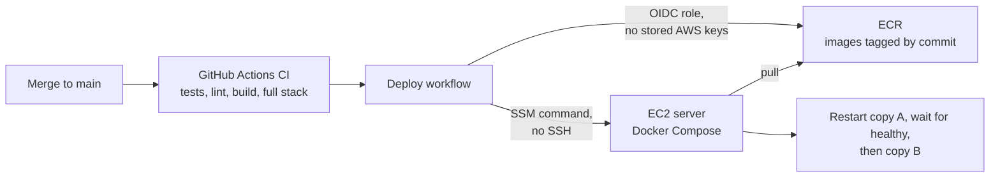
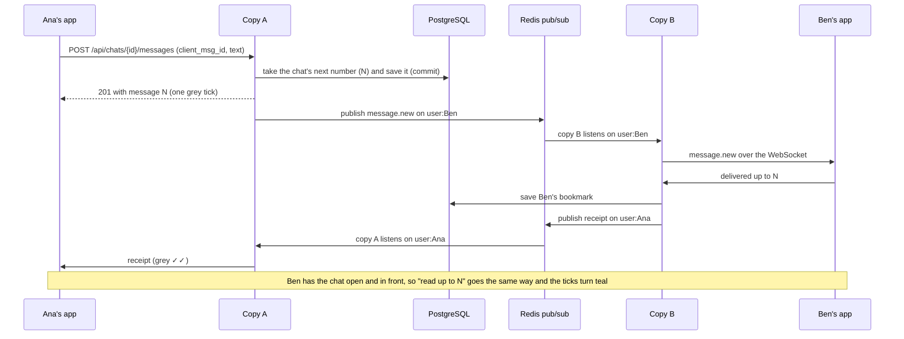

# Parley

A real-time chat web app, like WhatsApp Web, built to learn and show backend system design: live messages over WebSockets, two backend copies behind Nginx, Redis, RabbitMQ, load tests and Kubernetes.

**Live demo:** https://parley-adithya.duckdns.org (until Feb 2027). Sign up with any email, open it in a second browser as another person, and chat.

[](https://github.com/AdithyaChauhan/parley/actions/workflows/ci.yml)



| Desktop (from 1280 px) | Middle size (768-1279 px) | Phone |
|---|---|---|
|  |  |  |

## What works today

- Sign up and log in (argon2 passwords, a 15-minute access token and a rotating 7-day refresh cookie)
- One-to-one chats, started by email
- Groups of up to 50: add, remove, leave, rename and admins. New members see messages from when they joined, and people who left keep what they had, read-only
- Messages arrive live, with ticks: sent, delivered (grey ✓✓) and read (teal ✓✓)
- Photos, documents and voice notes, up to 10 MB, with progress and cancel. Files go straight between the browser and storage on short-lived signed links, and the server never opens them
- Reactions, editing your text for 15 minutes, and deleting your messages for everyone for 1 hour. A deleted message's text and file are really erased, and every change is caught up by number like a message
- Search across chats and inside a chat, with a jump to the message. It runs only in the browser, on the messages this device has loaded, the server never searches text, and the copy is wiped on log-out
- "typing...", online and "last seen"
- Offline sends wait in order and go out when the line is back, never twice. Missed messages are caught up by number
- Browser notifications (Web Push) that never contain the message text
- Spam limits, and a site that keeps working while Redis is down
- Desktop, middle and phone layouts, including the iPhone keyboard
- Two backend copies: stop one mid-chat and the chat carries on
- Every merge to `main` deploys itself to AWS, one copy at a time

## Architecture



- **PostgreSQL is the truth.** Redis only holds facts that may be lost: who is online, one-time tickets, rate limits, and pub/sub between the copies.
- **No sticky sessions.** Nothing about a user lives in one copy's memory, so any request or live line can go to either copy.
- **Notifications are a side job.** A send never waits for RabbitMQ, and jobs carry ids, never message text.
- **Files skip the backend.** The backend checks membership and signs a short-lived link, and the bytes go straight between the browser and the store.

How a merge reaches the server:



## How a message travels

Ana is on copy A and Ben is on copy B. Sending is plain HTTP, and everything live comes back over the WebSocket ([D3](DECISIONS.md#d3-how-messages-travel)).



- **Save first** ([D9](DECISIONS.md#d9-message-rules)): nothing is pushed until it's in PostgreSQL, so a lost push is never a lost message.
- **Numbers, not times** ([D18](DECISIONS.md#d18-how-message-numbers-are-kept-safe)): each chat numbers its messages #1, #2, #3 with one locked `UPDATE ... RETURNING`. A retried send carries the same `client_msg_id`, so it's never saved twice.
- **Pub/sub keeps nothing** ([D23](DECISIONS.md#d23-several-backend-copies-redis-pubsub)): if Ben is offline or a push is lost, his app asks for `messages?after=<last number with no gap>` when it reconnects ([D21](DECISIONS.md#d21-reconnect-and-catch-up)).
- **Ticks are two bookmarks per person** ([D20](DECISIONS.md#d20-live-events-and-ticks)): "delivered up to #" and "read up to #". They only move forward.

## Results

### Load test: 1,000 users on one laptop

k6 runs 1,000 fake users (500 one-to-one chats) through Nginx, with the target rate raised every 100 s. End to end means from the send until the partner's live line has the message. Everything, k6 included, shares one laptop (Ryzen 5 3550H, 3.4 GB for Docker), so these are laptop numbers, not server numbers.

| Offered | Accepted | End to end p50 / p95 | Refused with 503 "busy" |
|---|---|---|---|
| 10/s | 10.2/s | 26 / 146 ms | 0% |
| 20/s | 19.9/s | 53 / 2,190 ms (a laptop stall) | 0% |
| **30/s** | **30.3/s** | **50 / 407 ms** | 0% |
| 40/s | 37.4/s (the peak) | 3.5 s / 35 s | ~50% |
| 50/s | 29.3/s | 20 s / 96 s | ~80% |
| 60/s | 21.3/s | 16 s / 70 s | ~90% |

- **0 messages lost:** 14,840 saved and 14,840 received in this run. A 10-minute chat at ~50 messages/s (far past the limit) saved 11,506 and delivered 11,506, with 3 line drops.
- **The limit is ~35 messages/s, and it's CPU:** about one core per backend copy, while PostgreSQL stays under 0.4 cores.
- **Past the limit, nothing freezes.** Extra sends get a quick 503 (p95 3.9 s) and the app retries them with the same `client_msg_id`.
- **Before the fix**, the same test had p95 969 ms at 30/s, and 40/s froze both copies.
- 1,000 users connecting within 10 s all got their line, and 10 real logins a second all went through at no more than 206 MB per copy.

The table is the November 6 run, where the live lines split exactly 500 and 500. A clean re-run on November 7 reached the same peak (37.4/s) and lost nothing. Its 30/s step was slower because the lines came back 513 and 487 after a laptop stall, and `least_conn` then sent most requests to one copy.

Full write-up, method and the laptop's specs: [docs/load-test.md](docs/load-test.md).

### The freeze was a deadlock, not a leak

The first load test froze both copies at 40 messages/s, and I first blamed a connection leak from abandoned requests. Tests on the old code disproved it: hanging up and cancelling both gave the connection back. Landing 150 requests at once reproduced the real cause: requests held a database connection while they waited for a thread, and every thread waited for a connection. The fix keeps threads, connections and requests at work to one number per copy (8), opens a session only inside the work, and answers "busy, try again" (503) after 3 s instead of queueing forever ([D34](DECISIONS.md#d34-parley-under-load-fixes-from-t31)).

### Kubernetes demos (kind, on the laptop)

| Demo | Result |
|---|---|
| Two users chat through the front door | Send, live push (180 ms), ticks, typing, online and offline all work |
| 20 lines over two pods | Split **10 and 10** |
| Delete a pod mid-chat | All 13 lines moved within **8.8 s**. 190 messages, **0 lost** |
| Freeze a pod (SIGSTOP) | Traffic moved away at 18 s, and it **restarted by itself** at 69-74 s. 220 messages, **0 lost** |
| Rolling update at ~5 messages/s | 0 of 440 health asks failed. 547 messages, **0 lost** |
| Stop Redis for a minute | No backend restarted. 77 messages saved during the outage, all lines back 31 s after Redis returned |
| Delete the PostgreSQL pod | Back in **4.8 s** with the same data |

Details: [docs/kubernetes.md](docs/kubernetes.md).

## Problems I solved

- **A deadlock under load.** Both copies froze at 40 messages/s. *Cause:* a request held a database connection while it waited for a thread (15 connections, 40 threads). *Fix:* one number for threads, connections and requests at work, and a quick 503 instead of a queue. *Result:* no freeze in any run, and the limit went from ~30 to ~35 messages/s, now set by CPU ([D34](DECISIONS.md#d34-parley-under-load-fixes-from-t31)).
- **A login flood ate the memory.** At 10 logins/s, only 10 finished (p95 53.8 s) and a backend grew to 945 MB. *Cause:* every argon2 check takes 64 MB, and piled-up checks pushed the laptop into swap. *Fix:* at most 3 password checks at once per copy, then "busy, try again". *Result:* all 301 logins went through, p95 1.1 s, at most 206 MB per backend ([D34](DECISIONS.md#d34-parley-under-load-fixes-from-t31)).
- **The iPhone keyboard hid the chat.** The message box went under the keyboard, or the header slid off screen. *Cause:* on iOS the keyboard only shrinks the visible part of the page, so `100dvh` never changes. *Fix:* follow `visualViewport` into two CSS variables, lock the page, and scroll only the lists. *Result:* like WhatsApp: the header stays at the top and the box sits on the keyboard, checked in iPhone Safari and Chrome ([D8](DECISIONS.md#d8-look-updated), PR #29).
- **Health checks used a fifth of the server.** Idle CPU was 18.9%. *Cause:* checks that start Python or Erlang every 5 s. *Fix:* fast checks only while a container starts, then every 30 s. *Result:* 5.7% ([D27](DECISIONS.md#d27-containers)).
- **A 10-second gap on every deploy.** *Cause:* Nginx's default stop waits for every open live line. *Fix:* stop `web` with SIGTERM (the apps reconnect anyway), and restart the backend copies one at a time. *Result:* ~0.2 s ([D31](DECISIONS.md#d31-auto-deploy-t29)).
- **Ticks froze while Redis was down.** Badges came back and ticks stayed grey. *Cause:* "read" could only travel over the live line, which needs Redis. *Fix:* an HTTP door for `read` and `delivered` into the same function, plus a re-check every 60 s while the line is down. *Result:* during an outage, ticks still turn teal within about a minute ([D20](DECISIONS.md#d20-live-events-and-ticks), [D24](DECISIONS.md#d24-limits-and-when-redis-is-down)).

## Key design decisions

- **HTTP to send, WebSocket for everything live**: clear status codes and easy retries for sends, one live line for pushes ([D3](DECISIONS.md#d3-how-messages-travel)).
- **Per-chat numbers and `client_msg_id`**: order without trusting clocks, and a retry is never saved twice ([D18](DECISIONS.md#d18-how-message-numbers-are-kept-safe)).
- **Save first, push second**: a lost push only delays a message, and catch-up by number fills the gap ([D9](DECISIONS.md#d9-message-rules)).
- **Redis only for temporary facts**: when it's down, sending and history still work ([D22](DECISIONS.md#d22-redis-and-online-status), [D24](DECISIONS.md#d24-limits-and-when-redis-is-down)).
- **At-least-once notifications**: the worker acks only when done, and a Redis note stops a double notification ([D25](DECISIONS.md#d25-notifications-rabbitmq)).
- **The server never reads message text**: no text in notifications and no server-side search, ready for end-to-end encryption later ([D12](DECISIONS.md#d12-encryption-is-a-later-phase)).
- **Plain WebSockets, no Socket.IO**: reconnects, catch-up and "got it" replies are built by hand ([D4](DECISIONS.md#d4-plain-websockets-no-socketio)).
- **Files on signed links, plain S3**: the size and type are part of the signature, so the store itself refuses anything else, and Garage was picked by measuring memory on a 2 GB server ([D38](DECISIONS.md#d38-files-and-voice-notes-t36)).
- **AWS is optional**: the app has no AWS code, and everything AWS-only lives in `deploy/aws/` ([D29](DECISIONS.md#d29-aws-is-optional-never-required)).

All 35 decisions, with the reasons: [DECISIONS.md](DECISIONS.md).

## Run it yourself

You need Docker. On Windows, use Git Bash.

```bash
git clone https://github.com/AdithyaChauhan/parley.git
cd parley
cp .env.example .env   # replace every change-me, and set NOTIFIER=log (no push keys needed)
docker compose --profile app up --build
```

Then open http://localhost:8080. Add `--profile monitoring` for Prometheus and Grafana (http://localhost:3000). To run it on your own Linux server with HTTPS, see [deploy/README.md](deploy/README.md).

**Kubernetes** (kind, ~3.4 GB for Docker; stop the Compose stack first):

```bash
bash deploy/k8s/up.sh     # http://localhost:8090, about 9 minutes from nothing (needs kind and kubectl)
bash deploy/k8s/down.sh
```

**Tests** (the helpers from `docker compose up -d`, plus the `parley_test` database and vhost described in `.env.example`):

```bash
cd backend
python -m venv .venv && source .venv/Scripts/activate   # .venv/bin/activate on Linux and macOS
pip install -r requirements.txt
# Once, to get the file store ready:
STORAGE_ADMIN_TOKEN=dev-admin-token TEST_STORAGE_BUCKET=parley-files-test python -m app.files.garage_setup
pytest

cd ../frontend
npm ci && npm run lint && npm run build
```

**Load test:** `bash loadtest/run.sh b` (see [docs/load-test.md](docs/load-test.md)).

## Tech stack

- **Backend:** Python 3.13, FastAPI, SQLAlchemy 2 + Alembic, PostgreSQL 17, Redis 8, RabbitMQ 4 (pika), Garage (S3 file storage), Web Push (pywebpush), pytest
- **Frontend:** React 19, TypeScript, Vite, Tailwind CSS, shadcn/ui
- **Running it:** Docker Compose, Nginx, Kubernetes (kind, Kustomize)
- **Cloud and CI:** AWS (EC2, ECR, SSM, CloudWatch) with Terraform, GitHub Actions, Let's Encrypt
- **Measuring it:** Prometheus, Grafana, k6

## How I built this

I planned Parley with Claude (claude.ai) and coded it with Claude Code. I made the decisions and reviewed the work: every choice and its reason is in [DECISIONS.md](DECISIONS.md), one task per pull request. Up to and including the first load test (T31), I also tested every change myself. From the load fix on (build mode), Claude Code ran the checks and I reviewed the reports. [LEARNING.md](LEARNING.md) shows what I learned in each task.

The layout, colors and spacing follow the "KeyVue chat" design concept by [Karol Kos](https://dribbble.com/karol_kos) for widelab, on Dribbble ([reference screenshots](docs/reference/)). Parley's logo, names and avatars are its own.
