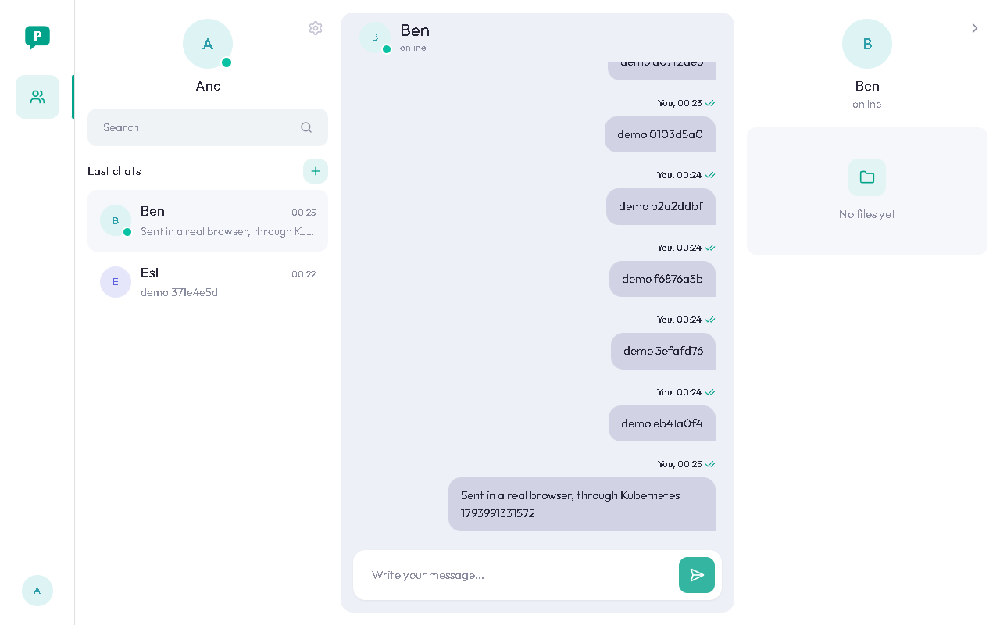

# Parley on Kubernetes (T32)

All of Parley on a small Kubernetes cluster on one laptop, at http://localhost:8090, and what Kubernetes adds compared with Compose. It's for learning and the demo: production stays on Docker Compose (D30, D31), and nothing here touches AWS or costs money (D35).

Runs: November 6-7, 2026. The full output of the seven demos is in [kubernetes/demo-run.txt](kubernetes/demo-run.txt).

## The short version

- **One command up, one command down.** From nothing, `up.sh` took 518 s (about 9 minutes) on the laptop. `down.sh` removes it all.
- **A stuck copy now restarts by itself**, which is what D34 was waiting for. Frozen with SIGSTOP, a backend pod lost its traffic after about 19 s and restarted after about 70 s, and nobody touched it.
- **A rolling update had no gap.** 0 of 440 health asks failed and 0 of 547 messages were lost at about 5 messages/s, with never fewer than 2 pods ready.
- **A deleted pod's 13 lines were all back on the other pod 8.8 s after the delete**, and a new pod was ready at 9.4 s.
- **The biggest limit here was the laptop, not Kubernetes.** With other apps open, Windows ran out of memory and stalled everything for tens of seconds, and that shaped the probe settings (see "What the demos found").

## Run it

You need Docker, `kubectl` (Docker Desktop includes it) and [kind v0.33.0](https://github.com/kubernetes-sigs/kind/releases/tag/v0.33.0). On Windows, put `kind-windows-amd64` in `~/bin/kind.exe`. Stop the Compose stack first: WSL has about 3.4 GB, and both won't fit.

```bash
docker compose --profile app --profile monitoring stop   # dev data stays in its volume
bash deploy/k8s/up.sh                                    # http://localhost:8090
bash deploy/k8s/down.sh                                  # removes the cluster and its data
docker compose --profile app --profile monitoring start  # back to how it was
```

Run `up.sh` again after a code change. It rolls out the new version. Without a new commit, name the version yourself: `PARLEY_TAG=try1 bash deploy/k8s/up.sh`.

To run the demos, with the cluster up: `backend/.venv/Scripts/python deploy/k8s/demo.py 1 2 3 4 5 6 7`.

## What runs where

| Compose service | Kubernetes object | Why that kind |
|---|---|---|
| `backend_a`, `backend_b` | Deployment `backend`, 2 replicas, headless Service | Any pod can be replaced. `COPY_NAME` is the pod's name |
| `worker` | Deployment `worker`, 1 replica | Keeps its jobs in RabbitMQ, not in the pod |
| `web` | Deployment `web`, 1 replica, NodePort Service on 30090 | Nginx is still the front door, with no ingress controller (D35) |
| `db` | StatefulSet `postgres`, 1 replica, 1 Gi volume, normal Service | Keeps its name and its own volume |
| `redis` | StatefulSet `redis`, 1 replica, 256 Mi volume, normal Service | As the brief asks. Compose has no Redis volume |
| `rabbitmq` | StatefulSet `rabbitmq`, 1 replica, 512 Mi volume, normal Service | The fixed name `rabbitmq-0` lets it find its old data |
| `migrate` | Job `migrate` | Finishes once. `up.sh` waits for it before starting or rolling the backends |
| `.env` (settings) | ConfigMap `parley-config` | Not secret |
| `.env` (secrets) | Secret `parley-secrets`, made by `make-secret.sh` | Never in a committed file |
| `frontend/nginx.conf` | ConfigMap from `deploy/k8s/nginx.conf` | A changed file gets a new name, so `web` rolls by itself |
| `depends_on` | `up.sh`'s order: helpers, migrate, then the app | One `kubectl apply` wouldn't wait |
| Compose `healthcheck` | Startup, readiness and liveness probes | Readiness moves traffic away, and liveness restarts |
| Port `8080` | Port `8090`, through `kind-config.yaml` | Never mixed up with Compose. Only this laptop can reach it |

Not moved: Prometheus and Grafana (not in T32).

## The seven demos

All seven passed in one run, on one cluster. The numbers below come from that run.

| # | Demo | Result |
|---|---|---|
| 1 | Two users chat through the front door | Send, live push (180 ms), grey and teal ticks, typing, online and offline all work |
| 2 | At least 20 lines over both pods | 20 lines from 5 users: **10 and 10**. Each pod's own count agrees |
| 3 | Delete a pod mid-chat | All 13 lines moved, the last at **8.8 s**. Each line took 1.5 s from close to back on. New pod ready at 9.4 s. 190 messages, **0 lost**, 0 failed health asks |
| 4 | Freeze a pod | **Restarted by itself at 74 s** (timeline below). 220 messages, **0 lost** |
| 5 | Rolling update at ~5 messages/s | 0 of 440 health asks failed. 547 messages, **0 lost**. Every answer afterwards shows the new version |
| 6 | Redis stopped for a minute | No backend or worker restarted, and health stayed at 200. 77 messages saved during the outage. All 15 lines back 31 s after Redis returned |
| 7 | Delete the PostgreSQL pod | New pod ready in **4.8 s**. **The same data**: 5 users, 2,200 messages, same fingerprint and same volume |

Demo 1 also ran in two real Chrome windows through `localhost:8090`, including the online dots and teal read ticks, with no page errors. Each window was on its own pod.



### Demo 4's timeline: three safety nets

| Time after freezing | What happened | Which part did it |
|---|---|---|
| 18 s | Readiness failed, so Nginx stopped sending new work | Kubernetes |
| 42-58 s | All the frozen pod's lines were back on the other pod | The app: no `pong` within 10 s (D21) |
| 69-74 s | Liveness failed, and the container restarted | Kubernetes |
| 74-78 s | The restarted container passed its probes | Kubernetes |

Times are from the last two runs. Before the readiness probe fails, a request can still reach the frozen pod and wait. Across the runs, 1-2 health asks timed out at 10 s, and one send waited 61 s (Nginx's 60 s limit) before its retry went through. Nothing was lost or doubled, since the retry carries the same `client_msg_id`.

### Demo 6: what a Redis outage looks like

This is D24 on Kubernetes. Lines close with 1011 at their next ping, tickets answer 503, and sends keep working but take 1-2 s instead of milliseconds, since each Redis call waits out its 1 s connect timeout. Lines come back within the app's backoff (at most 30 s, D21). Messages sent during the outage arrive by catch-up (129 of 167 in that run) and none are lost.

## Choices we measured

**How Nginx finds the backends.** We tried both of the brief's options, with 25 lines.

| Option | Split over several rounds |
|---|---|
| Headless Service + `upstream ... resolve` + `least_conn` | 13/12, 13/12, 13/12 |
| Normal Service (Nginx sees one address, and Kubernetes picks at random) | 16/9, 13/12, 14/11, 17/8 |

Headless wins: `least_conn` only works if Nginx can see each pod.

**The helpers use normal Services, not headless.** With Redis stopped behind a headless Service, its name had no address, and each lookup took **2.05 s** on top of D24's 1 s limit. A normal Service keeps its address, and a call gives up in **1.09 s**.

**A pause before stopping.** While a backend pod was being deleted, **27 and 29 asks still reached it**, the last 3.5-4 s after the delete, because Nginx re-checks names every 5 s. So the pod waits 6 s (`preStop`) before it stops, and in those two runs none of 839 asks failed (slowest 0.07 s). `web` waits 3 s, because 3 asks in one second failed when it rolled without a pause.

**Patient liveness probes.** At first, 30 s of no answers restarted a backend. On this laptop, healthy pods stalled for 30 s while images loaded and got restarted, so it's now about 60 s for `backend`, `web` and `worker`, and 2 minutes for PostgreSQL. Readiness (about 15 s) moves the work away long before that.

**Requests and limits**, from the demos and T31's logins.

| Container | Typical memory | Peak | Request | Limit | Peak CPU |
|---|---|---|---|---|---|
| backend | 92 MB | 158 MB (T31 logins: 206 MB) | 100m, 128 Mi | 1 core, 512 Mi | 1 core |
| worker | 78 MB | 90 MB | 50m, 96 Mi | 500m, 256 Mi | 0.4 core |
| web | 12 MB | 18 MB | 25m, 16 Mi | 500m, 64 Mi | 0.1 core |
| postgres | 68 MB | 93 MB | 100m, 128 Mi | 1 core, 512 Mi | 0.6 core |
| redis | 14 MB | 35 MB | 25m, 32 Mi | 500m, 128 Mi | 0.1 core |
| rabbitmq | 130 MB | 282 MB (its checks start Erlang) | 100m, 192 Mi | 1 core, 512 Mi | 1 core |

The whole cluster, including Kubernetes itself, used about 1.5 GB.

## What the demos found

- **A real bug, now fixed.** While RabbitMQ's pod restarted, its name didn't resolve. `socket.gaierror` isn't one of pika's errors, so the worker crashed instead of retrying (6 restarts). `queues.connect()` now treats it as "can't reach RabbitMQ". Compose never showed this. `test_a_name_with_no_address_counts_as_rabbitmq_being_down` fails on the old code.
- **The laptop stalls.** Windows had 200-550 MB free, about 1.8 GB in memory compression, up to ~3,000 pages/s and disk time at 248%. Loading images with other apps open stalled the whole machine for tens of seconds. Health asks timed out while images loaded, even though no pod was being touched. Close other apps for the smoothest run.
- **Kubernetes' own managers kept restarting** (8 and 9 times in an hour), losing their leader election during those stalls. While they were down, "scale Redis to 0" did nothing for over a minute, and an early demo 6 passed without Redis ever stopping. One node needs no election, so it's off in `kind-config.yaml`, and demo 6 now waits until Redis is really gone.

## Known limits

- Lines don't move back after a pod is replaced. New lines go to the emptier pod (21/4 became 21/9 in demo 3), but an uneven split stays until lines reconnect.
- The worker's probes check its `/metrics` page, which runs on its own thread. A stuck pod is caught, but a stuck job loop in a live process isn't.
- `up.sh` loads images again on every run (about 1 minute), even if nothing changed.
- Nginx's config exists in three places now: `frontend/nginx.conf`, `deploy/server/nginx.prod.conf` and `deploy/k8s/nginx.conf`.
- RabbitMQ works out its memory alarm from the machine's memory (2.1 GB), not its 512 Mi limit, so it would be killed before the alarm fired. It's far from that here (130-280 MB), and T33 should set it if RabbitMQ runs there.
- Five users and 4 tabs each stay within D24's limits, but barely: 10 tickets a minute per user is tight when many tabs reconnect at once. A real user has far fewer tabs.
- The Secret is only base64 in etcd, so anyone with access to the cluster can read it. That's fine on a laptop, but a real cluster would encrypt it.
