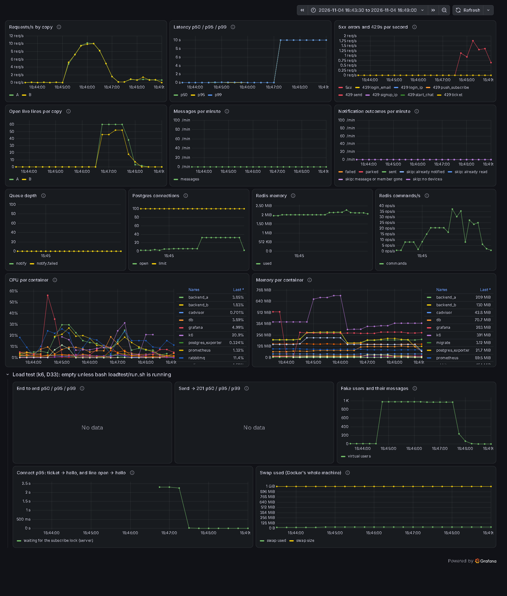
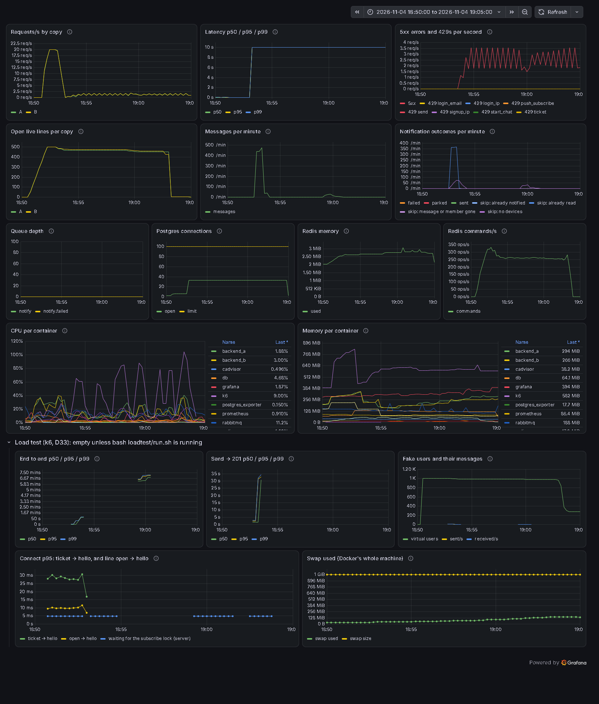
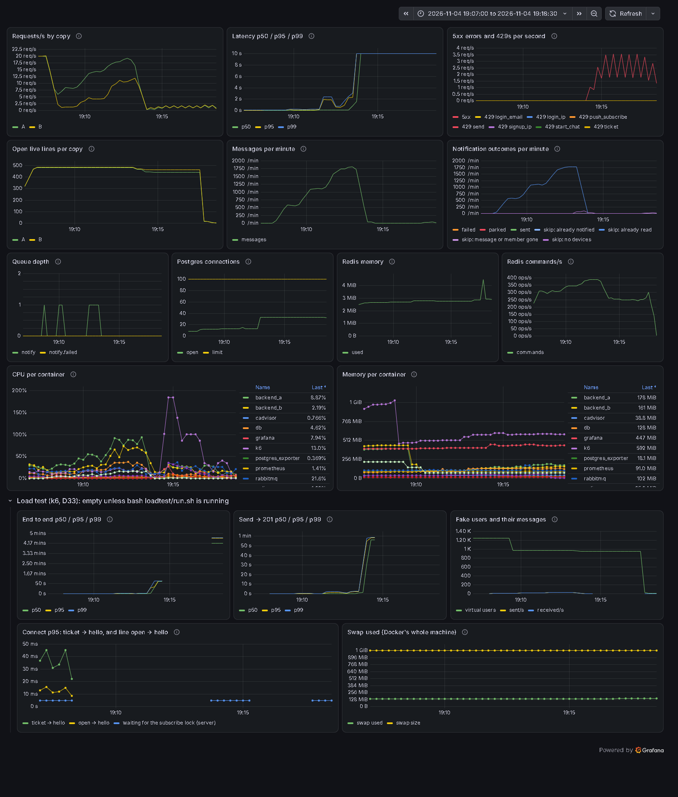
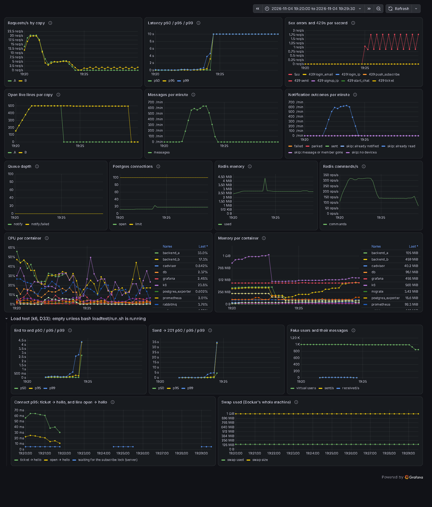

# Parley load test (T31)

1,000 fake users on one laptop, measured end to end and read from the Grafana dashboard (T30).
Runs: November 1-4, 2026. Times are the laptop's (IST, UTC+5:30), like the screenshots.

## The short version

- **With 1,000 users connected, Parley handles about 20 messages per second comfortably.** End to end (send → the partner's live line has it) is p50 28 ms, p95 80 ms and p99 164 ms, with 0 failed sends.
- **At about 30 messages per second it crosses the limit** (p95 end to end 969 ms). **Asked for 40 a second, both backend copies freeze.**
- **The bottleneck is database connections**, not CPU. Each copy has a pool of 15, and CPU stayed under 1 core per copy out of 8. When requests wait too long and are given up, **their connections are never handed back**. After 15 such leaks, a copy is frozen until it's restarted. The same freeze happens when 1,000 users connect within 10 s (scenario c), at a steady 50 messages/s (b), and when a copy dies and its ~500 users move to the other one (e).
- Real logins are limited by argon2 (64 MB and ~0.1-0.3 s per check). Up to 8 a second is fine on a fresh Docker. At 10 a second, the checks pile up into swap and almost nothing finishes.
- The first request after a quiet minute is not slow (the T30 question), whether the monitoring stack is on or off.

## The laptop

| | |
|---|---|
| Laptop | Acer Aspire 7 (A715-41G), Windows 11 Home (build 26300) |
| CPU | AMD Ryzen 5 3550H, 4 cores / 8 threads, 2.1 GHz base |
| RAM | 8 GB installed, 5.9 GB usable |
| Disk | 512 GB NVMe SSD |
| Docker | Docker Desktop 29.7.2 on WSL2: 8 CPUs, **3.4 GB RAM** (`memory=3584MB` in `.wslconfig`), 1 GB swap |

**Everything shares this one laptop:** Parley (Nginx, 2 backend copies, worker, PostgreSQL, Redis, RabbitMQ), the monitoring stack (Prometheus, Grafana, exporters, cAdvisor: ~0.6-0.8 GB) and k6 (up to ~0.6 GB and ~2 cores at its busiest). These are laptop numbers, not server numbers.

## How it was tested

- **k6 2.3.0** (`grafana/k6:2.3.0`) runs in Docker on Parley's own network and goes through Nginx, like a browser. It sends its numbers to Prometheus, so the dashboard shows them next to Parley's (the "Load test" row).
- **Its own data:** a fresh `parley_load` database for every run (1,000 users, 500 one-to-one chats), Redis database 1, and the rate limits off (`RATE_LIMITS_ENABLED=false`, which the app refuses when `COOKIE_SECURE=true`). The dev data was never touched: 11 users, 5 chats, 289 messages, 75 sessions, before and after.
- **Each fake user** (`loadtest/lib.js`) behaves like the app:
  1. It opens with a saved session: one refresh, no password.
  2. It gets a ticket and opens the live line, then pings every 25 s.
  3. It sends to its partner at random moments, at the planned average rate.
  4. It sends `read` for every message it gets.
  5. When a message number is skipped, or the line reconnects, it catches up by number.
- **Timing:**
  - *Send → 201* is timed by the sender.
  - *End to end* is timed by the partner: the send time is written inside the message, and both users run in the same k6 program, so they share one clock.
- **Lost** means a message saved in the database that the partner never received. The database count is the truth (`*.db.txt` files).
- Users start 10 a second, so 1,000 are ready in ~100 s. At 50 a second, the start itself froze both copies (see c, run 1). Every run ends within ~13 minutes, because the access token lasts 15 minutes.
- One command per scenario: `bash loadtest/run.sh trial|logins|a|b|c|d|e` (Git Bash, from the repo root). It seeds `parley_load`, switches the backends to it, runs k6, checks the database, saves `loadtest/results/<run>.json` and `.db.txt`, then puts the normal backends back.

## a. Baseline: the first request after a quiet minute

One user, 5 rounds. Each round: a quiet minute, then 4 health checks and 3 real logins in a row. The first of each counts as "first", the rest as "warm". In milliseconds, p50 / max:

| | health first | health warm | login first | login warm |
|---|---|---|---|---|
| monitoring on | 6.4 / 11.9 | 3.2 / 4.1 | 146 / 296 | 129 / 260 |
| monitoring off | 5.2 / 5.8 | 3.6 / 4.5 | 123 / 198 | 120 / 146 |

There's no real first-request penalty. With the monitoring stack on, a login after a quiet minute is ~20 ms slower. The ~0.9 s login seen in T30 didn't come back. That points at the laptop itself waking up from idle, not at the monitoring stack. During these runs the laptop was never fully idle (Docker and k6 were running), so that part isn't proven.

## Logins per second (argon2)

Real logins, one new arrival at a time whether or not the last one finished:

| logins/s | Nov 4, fresh Docker (~1.9 GB free) | Nov 1, Docker partly used (~1 GB free, ~0.3 GB in swap) |
|---|---|---|
| 2 | 49 ok, p95 227 ms (11 failed: see below) | 61 ok, p95 424 ms |
| 3 | 90 ok, p95 138 ms | 91 ok, p95 292 ms |
| 4 | 121 ok, p95 236 ms | 121 ok, p95 300 ms |
| 6 | 181 ok, p95 137 ms | **13 of ~90 done, p95 26 s**, backends ~900 MB each |
| 8 | 160 ok, p95 374 ms (probe) | |
| 10 | **36 of 200 done, p95 8.2 s**, backends ~800 MB each, ~450 MB swap (probe) | **0 done** |
| 12 | **0 done** (probe) | |

- Each argon2 check takes 64 MB and ~0.1-0.3 s. When checks pile up, memory runs into swap, each check gets slower, and more pile up. The rate where that starts depends on how much memory is free: 6/s on Nov 1, 10/s on Nov 4.
- The backends also keep working on requests nobody waits for any more.
- On the 2 GB server, a login flood could take the site down even with D24's per-IP limits. The fix is the next task (`fix/password-check-cap`).
- The 2-6 rows come from `loadtest/logins.js`. The 8-12 rows are a one-off probe with the same code. For the fix's before/after, `logins.js` needs the 8 and 10 steps, because on a fresh Docker 2-6 doesn't show the problem.
- The 11 failures at 2/s were 502s in the first 5 seconds: Nginx still had the old backend addresses (D28). `run.sh` now waits 12 s after switching the backends.

## c. Connection storm: 1,000 users connect within 10 s

Three runs (`loadtest/results/2026-11-04_*-c.*`):

| run | what happened |
|---|---|
| 18:20, users start 50/s | The start itself (refresh, then the chat list) ran each copy out of database connections. 600 of ~1,000 refreshes were given up after 60 s, and 0 lines connected. Both copies frozen. |
| 18:36, users start 10/s | The start was fine (1,000 of 1,000). In the storm, only 306 tickets were answered and 121 lines got hello (open → hello p50 1.2 s, p95 2.2 s), with 1,871 failed connects. Both copies frozen. |
| 18:43, + subscribe-lock timer | 24 hellos and 2,182 failed connects. Waits for the D23 subscribe lock: mean 0.21-0.45 s, p95 1.5-2.2 s, p99 2.3-2.4 s. Both copies frozen. |

- **D23's subscribe lock is a real queue in a storm.** Each copy subscribes one line at a time and waits for Redis to confirm, so lines wait up to ~2 s just for the lock. When users connect gradually (b, d, e), open → hello is only p50 6 ms and p95 13 ms.
- **The freeze, though, is the database pool** (below), not the lock.
- Spread between A and B: with gradual connects the split was exactly 500 | 500 (least_conn works). In the storm, too few lines connected to judge.

## b. Steady chat: 1,000 users, ~50 messages/s

Both copies froze within the first minute of chatting:

- 368 sends got their 201, and 99.7% of send tries failed after that.
- The database has 411 messages: 43 were saved, but their sender never heard back.
- Partners received 405.

The 100 s connect phase before it was healthy: connect p50 17 ms, open → hello p50 6 ms, and 500 | 500 lines per copy.

## d. Find the limit

1,000 users connected, with the target rate raised every 100 s:

| target | reached | end to end p50 / p95 / p99 | failed send tries |
|---|---|---|---|
| 10/s | 9.9/s | 25 / 53 / 77 ms | 0% |
| 20/s | 18.7/s | 28 / 80 / 164 ms | 0% |
| **30/s** | **28.7/s** | 45 / **969** / 1,454 ms | 0% |
| 40/s | 6.5/s | 1,004 ms / 29.8 s / 271 s | 90% (frozen) |
| 50/s | 0 | | 100% (frozen) |

**The limit (p95 end to end over 500 ms) is about 30 messages per second, and 20 a second is comfortable.**

What ran out first: **database connections**.
- CPU stayed low the whole time: backends ≤ 0.9 cores each, PostgreSQL ≤ 0.4, k6 ≤ 2, out of 8.
- Postgres connections went from ~13 to ~33: both pools full (30), plus the worker and the exporter. 25-30 of them were "idle in transaction".
- Thread dumps every 40 s showed each copy going from mostly idle threads, to a few database calls, to 30-40 threads waiting for a pool connection. Then it stayed there.

## e. Failover under load

1,000 users at ~10 messages/s, with `backend_a` stopped at 19:23:30, about 2 minutes into the chat. (At b's 50/s, both copies freeze with no failover at all.)

- Before the stop, it was healthy: end to end p50 31 ms, p95 94 ms.
- `backend_a` closed its 502 lines (code 1012), and they all tried to reconnect to `backend_b` within a second or two. **`backend_b` froze within a minute** (15 connections idle in transaction). None of the moved lines got back. `backend_b` kept its own ~500 lines open, but nothing that needs the database worked any more: sends, tickets, catch-up.
- Totals: 1,342 sent, all of them in the database, and 1,339 received. **3 messages were saved but never reached the partner**, because the catch-up that would have brought them couldn't run on the frozen copy. The database didn't lose them (D9), but during the test they never arrived.

The T26 failover demo works with a few users. With ~500 lines moving at once, the surviving copy freezes.

## The bottleneck: why a copy freezes

**The setup.** Each backend copy is one uvicorn process. Normal (`def`) routes, and the live line's database work, run in a pool of 40 threads. SQLAlchemy's connection pool has 15 connections per copy (5 + 10 overflow), and a request waits up to 30 s for one.

**The leak.** When a request waits long enough that Nginx or the client gives up (60 s), the request is cancelled. FastAPI closes the request's database session (`get_db`) when the request finishes or fails, but **not when it's cancelled**: in FastAPI's `contextmanager_in_threadpool`, the cleanup runs for normal endings and for `Exception`, and a cancellation is neither. Every route reads from the database after its commit, so that session has a transaction open, and its connection stays checked out: "idle in transaction", for good. After 15 leaks the copy has no connections left. All 40 threads wait for the pool, so even `/api/health` (a `def` route) can't run. Docker marks the copy unhealthy, but Compose doesn't restart unhealthy containers, so it stays frozen until someone restarts it.

**The evidence:**
1. In every frozen run, Postgres held exactly **15 "idle in transaction" connections per copy** (30 in c, b and d; 15 in e, where only `backend_b` was left), for 10+ minutes with no traffic.
2. Thread dumps (py-spy): **40 threads waiting in `QueuePool._do_get`**, and none inside a database call.
3. The copies came back only after a restart.

**What's not pinned down yet:** why requests hold their connections long enough to start the spiral at ~30 messages/s, when CPU, PostgreSQL and Redis weren't busy. Things to measure in the fix:
- Every send keeps its connection open while it publishes to Redis and to RabbitMQ (one shared RabbitMQ connection per copy, a confirm per message).
- There are 40 threads for 15 connections.

**Why it matters for production:** the server runs the same code. A burst, like a login flood, many reconnects at once, or a slow database for a minute, can freeze a copy there too, and nothing would restart it.

## What to change next

1. **Fix the connection leak first.**
   - Make the session cleanup safe against cancellation.
   - Make waiting for a connection fail fast (a pool timeout well below Nginx's 60 s), so a busy copy answers 503 instead of leaking.
   - Match the thread limit to the pool size.
   - Re-run c, b and d before and after.
2. **Restart a frozen copy automatically:** a health check that acts, like a Kubernetes liveness probe (T32).
3. **Find what holds connections at ~30/s:** a pool-wait timer, and giving the connection back before talking to Redis and RabbitMQ.
4. **The subscribe lock (D23):** subscribe in batches, or lock per channel. The storm showed waits of ~2 s.
5. **Cap concurrent password checks** (`fix/password-check-cap`, next in the plan), with 8 and 10/s added to `logins.js`.
6. **Spread reconnects out:** D21's random extra is 0-1 s, so ~500 lines came back within a second or two after a failover. A wider first wait would soften that.
7. **D15's async question:** the limit is the thread-and-pool model, not CPU. Async SQLAlchemy would remove the thread pool, but fixing the leak and sizing the pool come first. Then measure again.
8. **More copies don't help yet.** Each one freezes the same way, and each adds 15 connections toward PostgreSQL's limit of 100.

## Honest limits

- k6, Parley and the monitoring stack share one laptop with 3.4 GB for Docker. k6 itself used up to ~2 cores.
- Docker's memory state changes the login numbers (6/s on Nov 1, 10/s on Nov 4).
- A thread dump every 40 s is a sample, not a full picture.
- The 15-minute access token caps each run at ~13 minutes.
- "Lost" in the k6 summaries is sent minus received. It goes negative when timed-out sends were still saved, so the database count (`*.db.txt`) is the one to read.

## Files

- Scripts: `loadtest/` (`run.sh`, `lib.js`, `seed.py`, `compose.loadtest.yml`, `trial.js`, `logins.js`, `a-baseline.js` … `e-failover.js`). `loadtest/sessions.json` (raw refresh tokens) is made by the seed and gitignored.
- Results: `loadtest/results/` (one `.json` per run, plus a `.db.txt` with the database check and whether each copy still answered).
- Screenshots: `docs/load-test/`, taken with a temporary read-only Grafana and headless Chrome.
